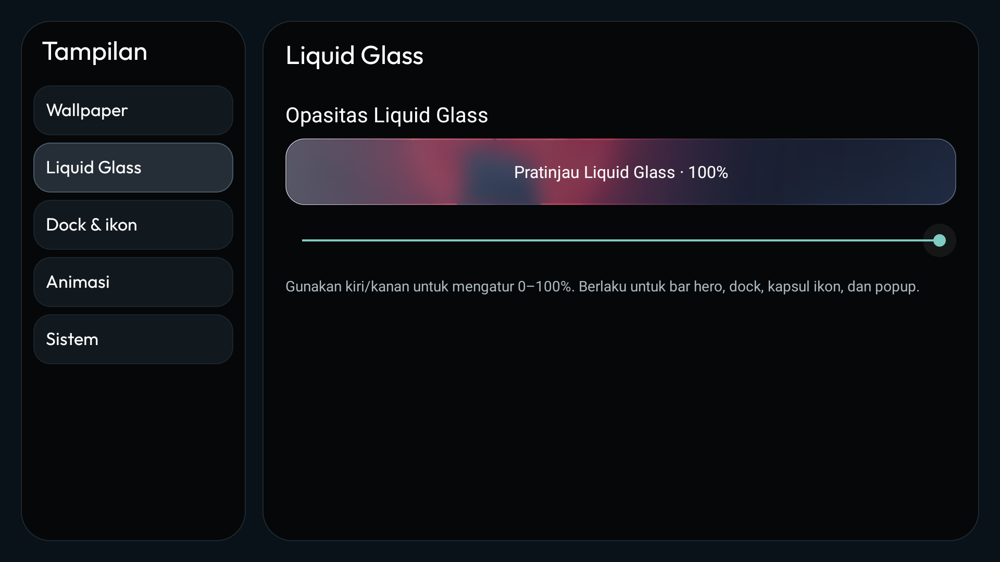

# W7 TV — Liquid Glass launcher

Custom launcher untuk TCL Android TV 11, dikembangkan dari [CleanYourTV](https://github.com/Gathin23/cleanyourtv). Pembaruan terakhir: 30 Oktober 2026, versi **3.4.1-liquid-glass** (versionCode 16), package `com.gathin.tvhome`.

## Perubahan

- Input TV, Wi-Fi, dan Settings dalam satu kapsul Liquid Glass.
- Tombol Settings remote TCL (keycode 4077) membuka Pusat Kontrol ketika berada di Home.
- Popup jaringan dan input, Pusat Kontrol, hero judul aplikasi, dan dock memakai material Liquid Glass native dengan wallpaper blur yang disimpan di cache.
- Ikon Google Material Icons Round dan teks Indonesia/Inggris mengikuti bahasa launcher/sistem.
- Header jam tanpa latar: jam, garis merah, sapaan, lalu hari dan tanggal lengkap. Font Outfit semula dipertahankan.
- **Pusat Kontrol → Tampilan** membuka halaman dengan kategori di kiri: Wallpaper, Liquid Glass, Dock & ikon, Animasi, Sistem.
- Galeri wallpaper dengan thumbnail, mode otomatis, dan interval 1/5/15/30 menit atau 1/3/6/24 jam. Wallpaper dapat ditahan dengan mematikan mode otomatis.
- Satu slider **Opasitas Liquid Glass 0–100%** mengatur hero, dock, kapsul ikon, dan popup sekaligus. Tombol kiri/kanan mengubah nilai 5%.
- Input duplikat di Pusat Kontrol dihapus; Input di kapsul kanan atas tetap tersedia.



## File yang disimpan

- [`launcher/`](launcher/): source launcher lengkap dan Gradle wrapper.
- [`releases/3.4.1-liquid-glass/`](releases/3.4.1-liquid-glass/): APK terbaru dan APK pemulihan tampilan lama.
- [`docs/liquid-glass/PANDUAN.md`](docs/liquid-glass/PANDUAN.md): cara pakai, build, dan pemulihan.
- [`docs/liquid-glass/verification.json`](docs/liquid-glass/verification.json): versi, checksum APK, hasil pemeriksaan, dan batas pengujian.
- [`shots/liquid-glass/`](shots/liquid-glass/): screenshot dari TV; beberapa screenshot merekam tahap verifikasi sebelumnya.
- [`README-w7-setup.md`](README-w7-setup.md): arsip setup debloat awal. Informasi IP, dock, dan perintah di arsip menggambarkan keadaan awal, bukan konfigurasi terbaru.

## Build

Butuh JDK 17+, Android SDK 34, serta akses untuk mengunduh dependensi Gradle.

```powershell
Set-Location launcher
.\gradlew.bat --no-daemon testReleaseUnitTest lintRelease assembleRelease
```

APK hasil build berada di `launcher/app/build/outputs/apk/release/app-release.apk`.
Android SDK lokal dikonfigurasi melalui `ANDROID_HOME` atau `launcher/local.properties` milik masing-masing komputer.
APK disediakan dengan signature yang sama dengan launcher terpasang pada TV pengguna. Build di komputer baru menggunakan debug keystore berbeda sehingga tidak dapat langsung menggantikan APK ini tanpa keystore yang cocok. Keystore tidak disimpan di repo.

## Pasang dan pulihkan

Gunakan alamat ADB TV yang sedang berlaku. Contoh PowerShell setelah `adb` tersedia:

```powershell
adb connect <IP-TV>:5555
adb -s <IP-TV>:5555 install -r releases/3.4.1-liquid-glass/Liquid-Glass-TV.apk
adb -s <IP-TV>:5555 shell am start -n com.gathin.tvhome/.MainActivity
```

Gunakan `install -r` untuk mempertahankan data. APK pemulihan `launcher-restore.apk` memiliki versionCode 17; setelah memasangnya, build pembaruan berikutnya harus memakai versionCode lebih tinggi. Tidak perlu menjalankan ulang debloat untuk memasang desain launcher.

Pengaturan pribadi yang disimpan di data privat aplikasi, wallpaper galeri pengguna, password, kunci ADB, serta keystore penandatanganan tidak disertakan dalam pembaruan ini. Source dan APK menyimpan implementasi perubahan; repo bukan salinan penuh data privat TV.

## Verifikasi dan lisensi

263 unit test lulus; Android lint tidak menemukan error. D-pad, slider beserta penyimpanan nilai, galeri, dan rotasi wallpaper diuji pada TV. Nilai 0% diverifikasi menghilangkan material hero, dock, dan kapsul bersama-sama; teks serta ikon tetap terlihat. Tidak ada benchmark FPS atau uji restart.

Material merupakan pendekatan native yang ringan, bukan simulasi optik penuh WebGL. Pengaturan gambar, suara, brightness, dan kredensial Wi-Fi tetap membuka halaman sistem TV. Tombol Settings dari aplikasi lain belum didukung oleh penanganan di Home ini.

Source asal berlisensi MIT ([LICENSE](LICENSE)); ikon Material berlisensi Apache 2.0 dan font Outfit berlisensi SIL OFL, masing-masing disertakan dalam folder launcher. Konsep Liquid Glass dipelajari dari [iyinchao/liquid-glass-studio](https://github.com/iyinchao/liquid-glass-studio).
